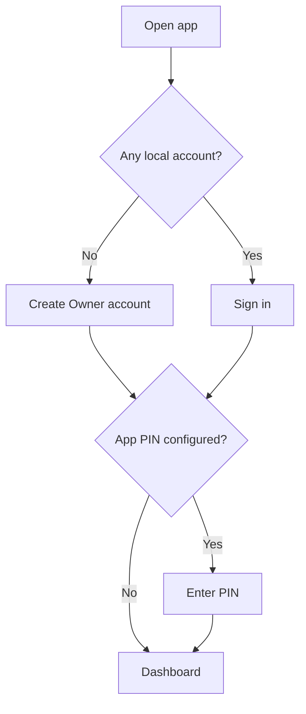
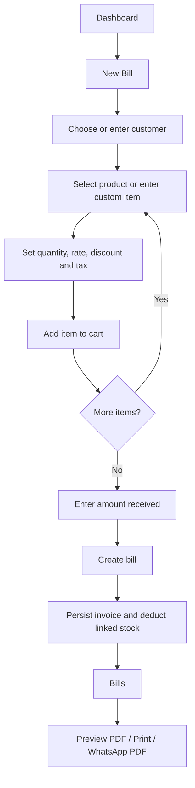
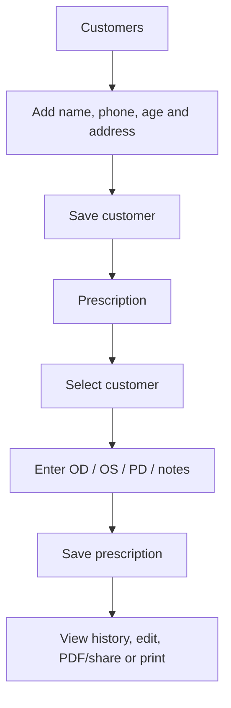
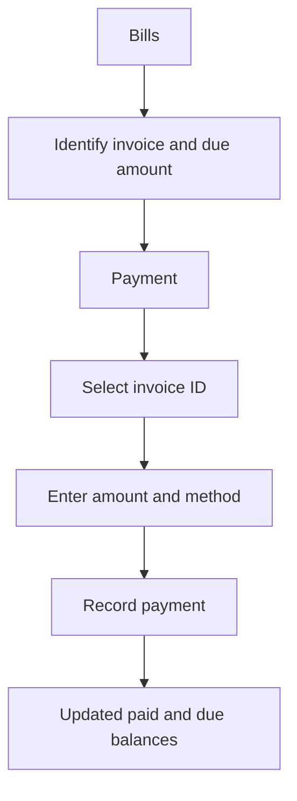

# Surya Optician — App Layout, Screen Map & User Flows

> **Purpose:** This document is the source of truth for the current Android UI and user journeys. It describes the screens implemented in the Kotlin/Jetpack Compose app, not a proposed redesign or a screenshot from a running phone. Exact spacing can vary with Android screen size, font scale and system insets.

- **Platform:** Android phone app
- **Application ID:** `in.surya.optician`
- **UI:** Kotlin + Jetpack Compose Material 3
- **Local persistence:** Room / SQLite
- **Primary activity:** `app/src/main/java/in/surya/optician/MainActivity.kt`
- **Data models / database:** `app/src/main/java/in/surya/optician/data/Models.kt` and `OpticianDatabase.kt`
- **Invoice PDF:** `app/src/main/java/in/surya/optician/invoice/InvoicePdf.kt`

## 1. Visual design system

The app uses a professional, light optical-retail style:

| Token | Current value | Use |
|---|---|---|
| Primary navy | `#123A63` | Main buttons and selected navigation |
| Secondary blue | `#2677A8` | Supporting actions |
| Page background | `#F4F7FB` | Main screen background |
| Surface | `#FFFFFF` | Cards and input surfaces |
| Light blue | `#DCEBFA` | Primary summary cards |
| Pale blue | `#E2F2FC` | Secondary summary cards |
| Outline | `#D5DEE8` | Input/card outlines |
| Small / medium / large corner radius | 12 / 18 / 24 dp | Material 3 shape system |

**Layout behavior:** the app is a single-activity, vertically scrollable phone UI. The section navigation is a horizontally scrollable row so all destinations remain reachable on narrow screens. Forms and cards generally use the available width. It is not a tablet-specific multi-pane layout.

## 2. App entry and authentication

### First launch — no account exists

```text
┌──────────────────────────────────┐
│          SURYA OPTICIAN           │
│                                  │
│      Create owner account        │
│  Username                         │
│  [____________________________]   │
│  Password                         │
│  [____________________________]   │
│  Confirm password                 │
│  [____________________________]   │
│  [       Create owner account ]   │
└──────────────────────────────────┘
```

The first account is the Owner account. Once created, the app opens the Dashboard.

### Returning user

```text
┌──────────────────────────────────┐
│          SURYA OPTICIAN           │
│          Sign in                  │
│  Username                         │
│  [____________________________]   │
│  Password                         │
│  [____________________________]   │
│  [             Sign in          ] │
└──────────────────────────────────┘
```

The app stores local account records on this device. Passwords are stored as salted PBKDF2 hashes, not plain-text passwords. Accounts do **not** sync between devices and this is not cloud identity/authentication.

### Optional app PIN

If a PIN has been configured in Settings, after sign-in the user must unlock with the 4–8 digit PIN. The PIN is local to this app installation; there is no online PIN recovery. Clearing app data removes local app data, so back up important shop records first.

## 3. Main app shell

After sign-in (and PIN unlock if enabled), the screen has a top app bar, navigation tabs, two always-visible summary cards, and the selected section below them.

```text
┌──────────────────────────────────┐
│ Surya Optician             Sign out│
├──────────────────────────────────┤
│ Dashboard  Bills  New Bill  ... → │  ← horizontal scroll
├──────────────────────────────────┤
│ Outstanding          Low stock    │
│ ₹ amount              item count  │
├──────────────────────────────────┤
│                                  │
│      Selected screen content     │
│      scrolls vertically          │
│                                  │
└──────────────────────────────────┘
```

Navigation destinations in the current code:

1. Dashboard
2. Bills
3. New Bill
4. Customers
5. Products
6. Payment
7. Prescription
8. Reports
9. Settings
10. Users — displayed when the signed-in local account has the Owner role

The role currently controls whether the **Users** destination is displayed. Fine-grained permission enforcement for every operation is not implemented; do not treat the role label as a production security boundary.

## 4. Screen-by-screen layout

### 4.1 Dashboard

**Top to bottom:**
- Greeting using the signed-in username and “Your shop at a glance”
- Four metric cards: invoice count, customer count, product count, low-stock count
- Quick actions: **Create a new bill**, **Manage customers**, **Manage inventory**
- Recent bills (up to five), each showing invoice number, total, customer, and paid/due status
- Main shell summary cards above the content: outstanding balance and low-stock item count

**Primary path:** Dashboard → Create a new bill → Bills → Preview / Print / WhatsApp PDF.

### 4.2 Customers

**Form fields in order:**
1. Customer name (required)
2. Phone (WhatsApp)
3. Age in years (optional; accepts 0–120)
4. Address
5. Save customer / Update customer button
6. Cancel customer edit (only while editing)

Below the form:
- Search by customer name or phone
- Customer cards with name, phone, age and address when present
- Edit and Delete actions

A customer with invoice or prescription history cannot be deleted. Existing customers remain valid when age is blank; the database migration adds the optional age column without intentionally deleting customer rows.

### 4.3 Products / Inventory

**Form fields:** product/frame/lens name, optional SKU, selling price, purchase cost per unit, category, opening/current stock, low-stock threshold.

Below the form:
- Save product / Update product & stock
- Search by name, SKU or category
- Product rows/cards with ID, name, selling price, cost, category and stock
- Edit and Delete actions

Products referenced by invoice history cannot be deleted. The purchase cost is used for estimated profit and inventory cost calculations.

### 4.4 New Bill

The bill composer is a vertically stacked form:

1. Optional existing customer ID and selectable customer list
2. Customer name and phone
3. Product selector list showing ID, name, price and stock
4. Item fields: optional product ID (blank for a custom item), description, quantity, unit rate, line discount and line tax
5. **Add item to bill**
6. Cart item count, total and item summary
7. Amount received
8. **Create bill and deduct stock**

A bill requires a customer name or a valid selected customer, at least one item and a valid payment amount. A selected existing product is linked to the invoice item and stock is deducted by the billing flow. Successful creation navigates to **Bills**.

### 4.5 Bills

- Search invoices by invoice number, customer or phone
- Export the visible invoice list as CSV
- Each invoice card shows invoice number, customer, total, amount paid and due amount
- **Preview PDF**, **Print**, and **WhatsApp PDF** actions
- **Payment reminder** appears when an invoice has a balance due; the user confirms/continues to WhatsApp

PDF sharing opens Android's share/WhatsApp flow. The app cannot guarantee message delivery or independently verify the recipient selected in WhatsApp.

### 4.6 Payment

- Invoice database ID
- Payment amount
- Payment method (e.g. Cash / UPI / Card / Bank)
- **Record payment**
- Invoice list to select an invoice and view its payment history
- History rows show date/time, amount, method and reference when present

Recording a payment updates the invoice's collected amount and outstanding balance through the billing repository.

### 4.7 Prescription

- Customer ID and quick-select list of customers
- Right eye (OD): SPH, CYL, Axis (0–180), ADD
- Left eye (OS): SPH, CYL, Axis (0–180), ADD
- Pupillary distance (PD, mm)
- Notes / lens recommendation
- Save / Update prescription and cancel edit
- Prescription history for the selected customer
- Edit, PDF / Share, Print and Delete actions on saved records

**Important:** enter the prescription exactly as provided by the prescribing optometrist. This app stores entered details; it does not diagnose or validate a clinical prescription beyond basic axis range checks.

### 4.8 Reports

**Filters:** From date and To date in `YYYY-MM-DD` format, plus invoice/customer/phone search.

**Summary cards and sections:**
- Invoice count and sales
- Collected amount and outstanding amount
- Estimated gross profit excluding tax
- Current stock units, inventory cost value and current retail value
- Stock grouped by category, with low-stock warnings
- Customer invoice list with date, sales, paid and due amounts
- Export date-filtered invoices to CSV

Dates use the device's local time zone. Estimated gross profit is not net profit: it excludes operating expenses, and older invoices without historical cost snapshots cannot provide reliable historical profit.

### 4.9 Settings

- Shop name, address, phone, GSTIN and invoice footer
- Save shop settings (used by invoice documents)
- Optional local 4–8 digit app PIN: set/change or disable
- Export database backup
- Restore a database backup

Restore replaces the current local database. Only restore a valid backup created by this app, and keep a separate safe copy before restoring. This is a local-device backup feature, not cloud sync.

### 4.10 Users (Owner only in navigation)

- Create local staff username and temporary password (8+ characters)
- Select Staff or Manager role
- View local accounts and roles
- Remove non-owner accounts, with safeguards for the currently signed-in account and Owner account

Accounts are stored on this device only. A second phone will not automatically see these users or the shop data.

## 5. Main user journeys

### A. First-time setup



### B. Create a bill and share it



### C. Customer and prescription



### D. Payment collection



## 6. Invoice PDF layout

The generated invoice PDF is a separate printable document, not the same screen as the bill form. The PDF uses a branded optical-shop header and presents the transaction in a clear billing hierarchy:

```text
┌────────────────────────────────────────────┐
│ SURYA OPTICIAN                 INVOICE      │
│ Shop address / phone / GSTIN   Number/date │
├────────────────────────────────────────────┤
│ BILL TO: customer name / contact            │
│ Payment status: PAID or BALANCE DUE         │
├────────────────────────────────────────────┤
│ Item description | Qty | Rate | Tax | Total │
│ ...                                        │
├────────────────────────────────────────────┤
│ Subtotal                         ₹         │
│ Discount                         ₹         │
│ Tax                              ₹         │
│ GRAND TOTAL                      ₹         │
│ Paid                             ₹         │
│ Balance due                      ₹         │
├────────────────────────────────────────────┤
│             Shop thank-you footer          │
└────────────────────────────────────────────┘
```

The actual PDF is generated from invoice data and the shop settings saved on the device. Exact wrapping and page breaks depend on the number and length of invoice items.

## 7. Local data and persistence

Room/SQLite currently stores these core entities:

- Customers (including optional age)
- Products (SKU, category, selling/purchase cost, stock and low-stock threshold)
- Invoices and invoice items
- Payments
- Prescriptions
- Shop settings

The customer age addition uses a Room migration from database version 3 to 4. Existing databases should upgrade through the registered migrations rather than requiring a fresh install; verify upgrades with a real-device test before using production data.

## 8. Build and release verification

- GitHub Actions workflow: [Android build and tests](../.github/workflows/android.yml)
- Latest known successful build for the customer-age change: [workflow run](https://github.com/solankiabhay/SuryaOpticianApp/actions/runs/40668406686)
- Latest age-validation unit-test change: [check the workflow here](https://github.com/solankiabhay/SuryaOpticianApp/actions)

A successful CI build proves the code compiled and automated unit tests passed for that commit; it does not prove the UI has been visually accepted on every phone. Complete the [real-device acceptance checklist](REAL_DEVICE_ACCEPTANCE.md) before real shop use.

## 9. Known boundaries / not yet promised

- No cloud database, cross-device synchronization or online account recovery.
- Role names exist, but comprehensive role-based authorization is not implemented.
- This document describes the current screen implementation; it is not a pixel-perfect device screenshot or a guarantee of a future redesign.
- Backup/restore, PDF print/share, WhatsApp handoff, database migration and all workflows still need acceptance testing on a physical Android device.
- Reports are estimates and should not be treated as audited accounting outputs.
